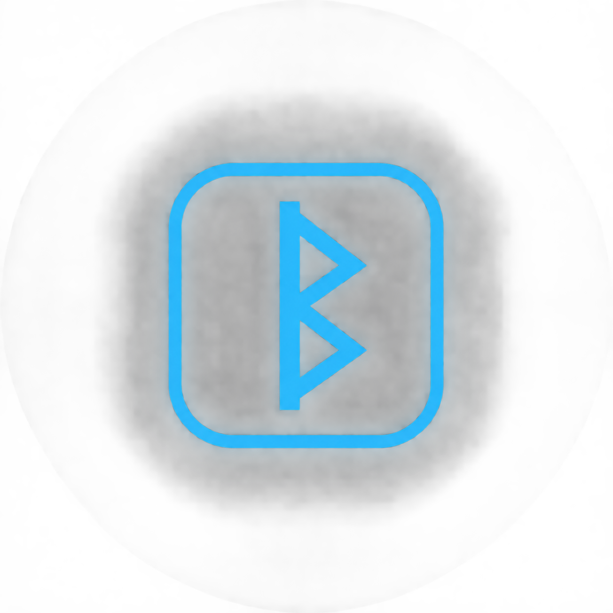
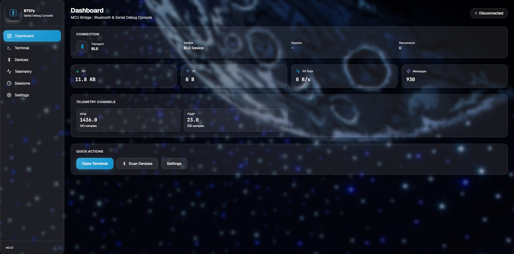
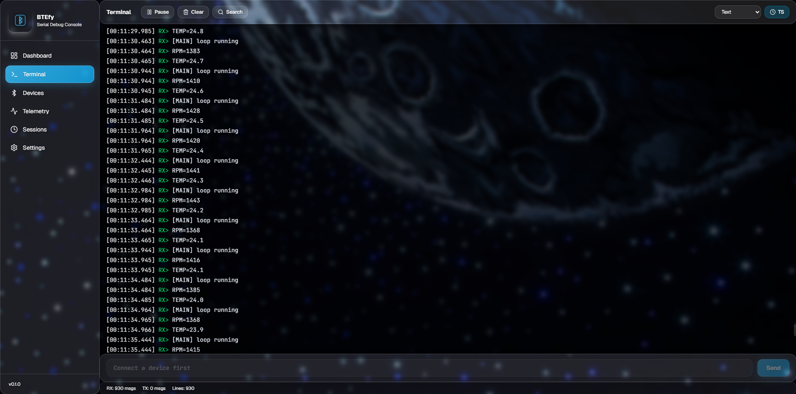
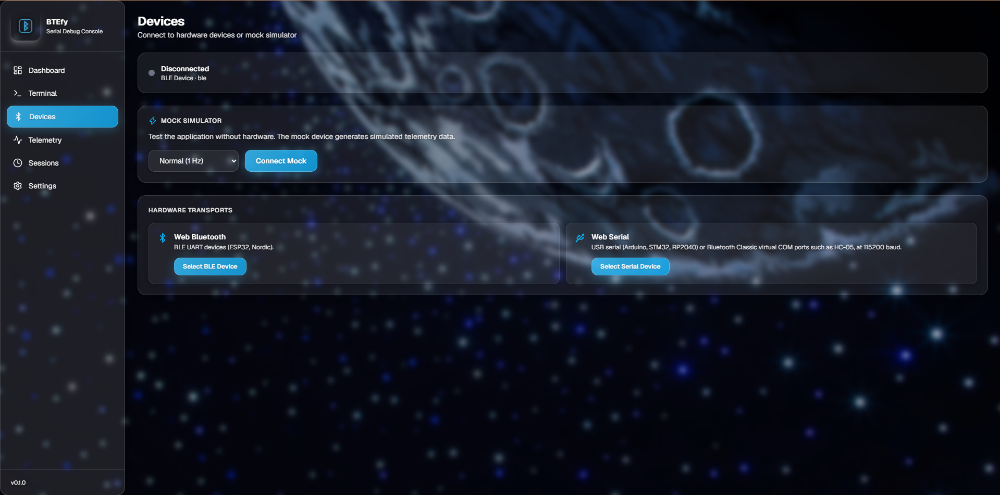
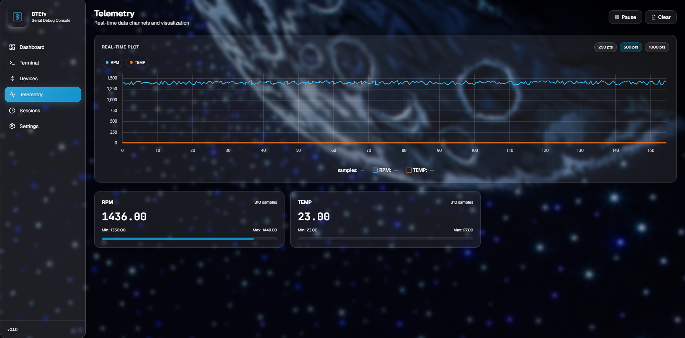
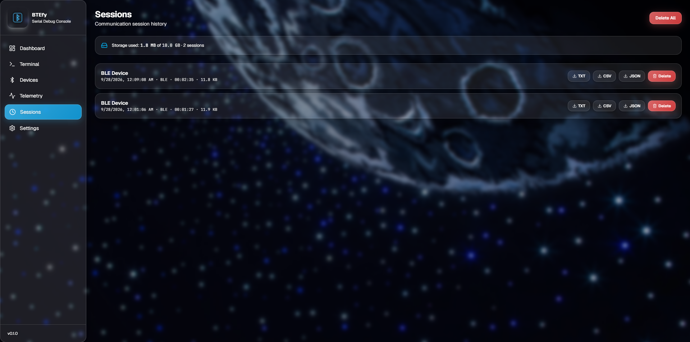
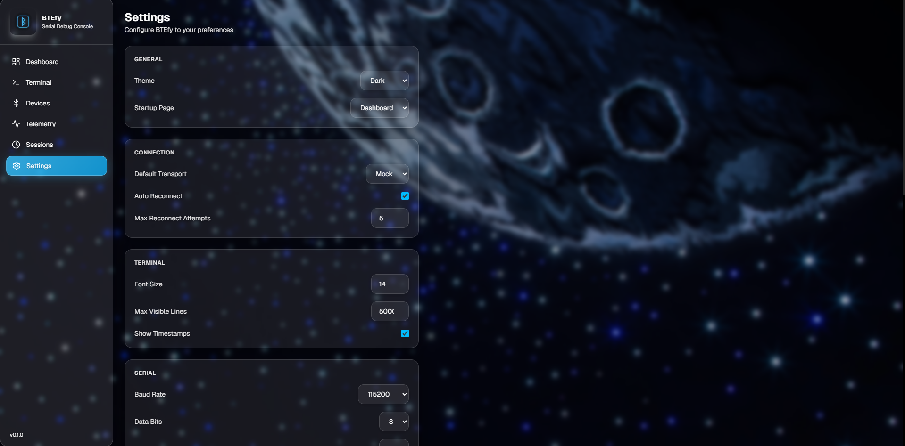
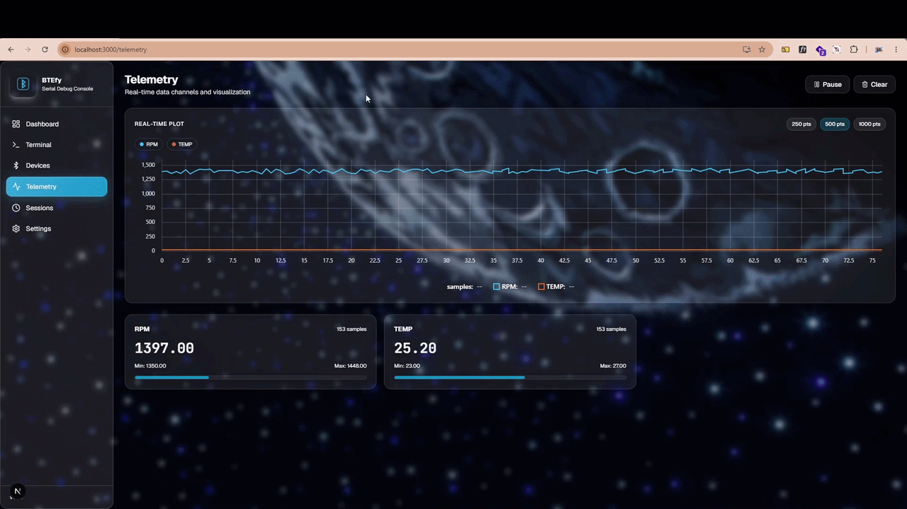

<div align="center">

<h1>BTEfy</h1>



<p>
  <a href="LICENSE"></a>
  
  
  
  
</p>

<h4><b>BTEfy is a browser-based debug console for microcontrollers.</b> It connects to
ESP32, Arduino, STM32, RP2040 and HC-05 boards over Bluetooth Low Energy or
USB serial, prints their output in a terminal, plots telemetry as it
arrives, and records sessions for later export. Chrome or Edge is the only
dependency. There is no desktop client and no server-side hardware code;
the browser talks to the device directly.</h4>

</div>

## Features

- Web Bluetooth with Nordic UART, ESP32 BLE UART and HM-10 profiles, plus
  GATT characteristic inspection.
- Web Serial for USB CDC, UART adapters and HC-05 virtual COM ports.
- Terminal with text, HEX and HEX+ASCII display modes, timestamps, search,
  history and pause.
- Telemetry parsing for `KEY=VALUE`, `KEY:VALUE` and JSON Lines input.
- Live uPlot charts fed by fixed-size ring buffers.
- Session recording in IndexedDB, with TXT, CSV and JSON export.
- Saved device profiles, favourites and command presets.
- Mock simulator with normal, 100 Hz and fault-injection modes.
- Installable PWA with an offline app shell.

## Requirements

**Browser.** Chrome or Edge on desktop. Web Bluetooth
and Web Serial are secure-context APIs, so the app must be served over
HTTPS. `localhost` is exempt and works during development.

**BTEfyDebug driver.** BLE firmware has to expose the Nordic UART Service
(6E400001-B5A3-F393-E0A9-E50E24DCCA9E). BTEfy ships this driver as
`driver/BTEfyDebug.zip`. In Arduino IDE, install it through
Sketch -> Include Library -> Add .ZIP Library, then include it with
`#include <BTEfyDebug.h>`.

**NimBLEDevice library.** The driver is built on NimBLE-Arduino, which
provides the `NimBLEDevice` API. Version 2.0.0 or newer is required.
Install it from the Arduino Library Manager before compiling the driver.

**Hardware.** ESP32 over BLE or USB serial; Arduino, STM32 and RP2040 over
USB serial; HM-10 modules over BLE; HC-05 through its OS virtual COM port.

## Getting started

1. Install `driver/BTEfyDebug.zip` and the NimBLE-Arduino library.
2. Flash a sketch that uses the driver:

   ```cpp
   #include <BTEfyDebug.h>

   void setup() {
     Serial.begin(115200);
     BTEfy.begin("MyRobot", "1.0.0");
   }

   void loop() {
     BTEfy.println("hello");                       // terminal line
     BTEfy.log("WIFI", "connected");               // [WIFI] connected
     BTEfy.metric("TEMP", 25.4);                   // TEMP=25.40, plotted
   }
   ```

3. Open BTEfy in the browser, go to Devices, and select the device from the
   BLE picker.

Reference firmware without the driver: `examples/ble-demo/`,
`examples/generic-uart/`.

## Development

```bash
npm install
npm run dev      # http://localhost:3000
npm run lint
npm run test
npm run build
```

## Screenshots

<table>
    <tr>
        <td></td>
        <td></td>
        <td></td>
    </tr>
    <tr>
        <td></td>
        <td></td>
        <td></td>
    </tr>
</table>

### Demo



## Telemetry format

```
TEMP=25.4,VOLT=11.82,CURR=1.25,RPM=1430
{"temp":25.4,"voltage":11.82}
```

Both delimiters (`=` and `:`) and JSON Lines are accepted on the same
stream. Details in `docs/telemetry.md`.

## Documentation

- `docs/bluetooth.md`: BLE profiles, driver, HM-10 modules
- `docs/serial.md`: Web Serial, COM ports, HC-05
- `docs/telemetry.md`: parsing rules and chart behaviour
- `docs/troubleshooting.md`: connection and capability problems
- `docs/architecture.md`: module layout and data flow

## Privacy

Device data stays on your machine: browser to IndexedDB, no cloud sync.
Exports are local file downloads. There are no accounts and no tracking.

## License

BTEfy is released under the Apache License, Version 2.0. Copyright 2026
Al Mahmud Samiul.

The full license text is in `LICENSE`. `NOTICE` carries the attribution
notices required by the license, including those of bundled third-party
components.
